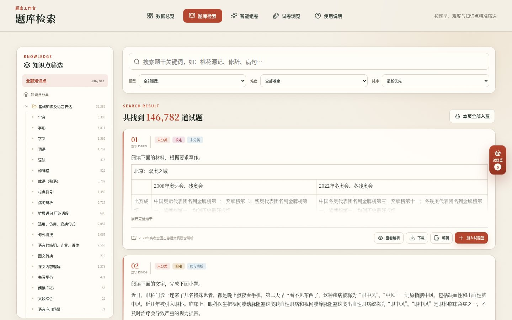
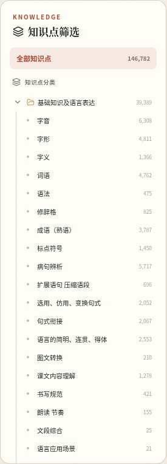
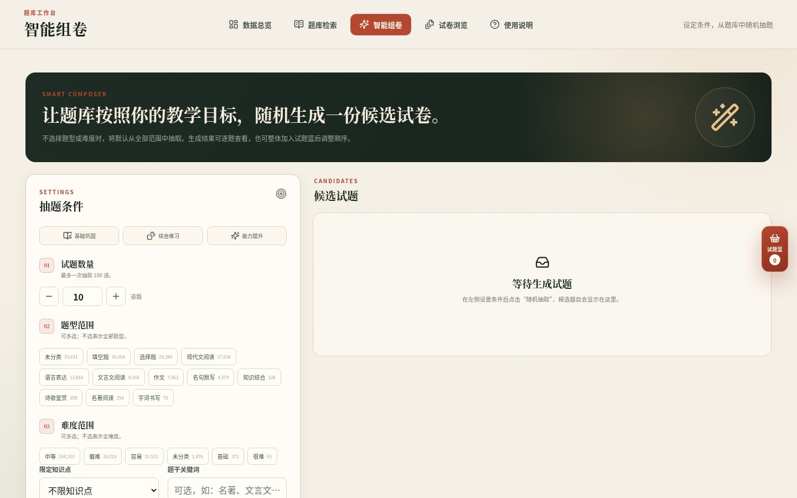
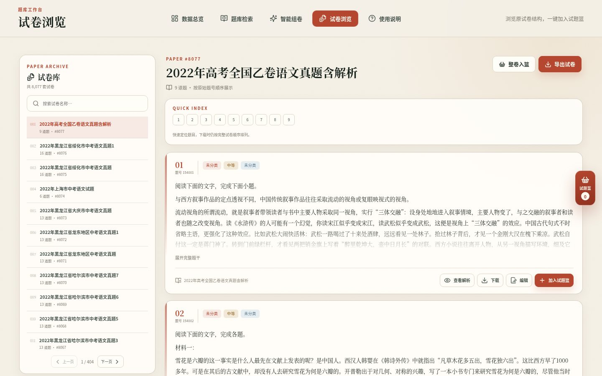
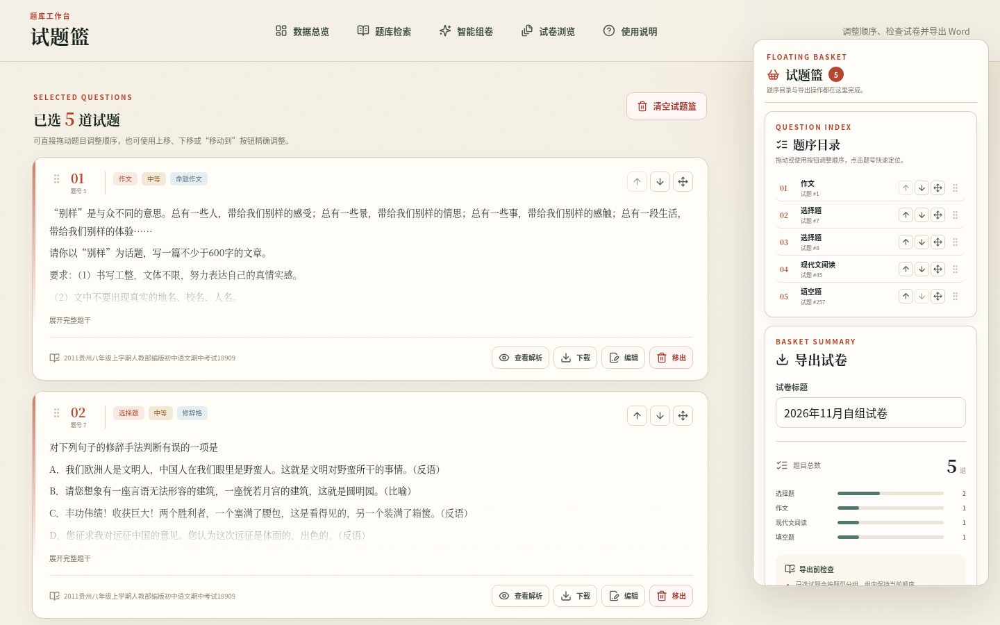
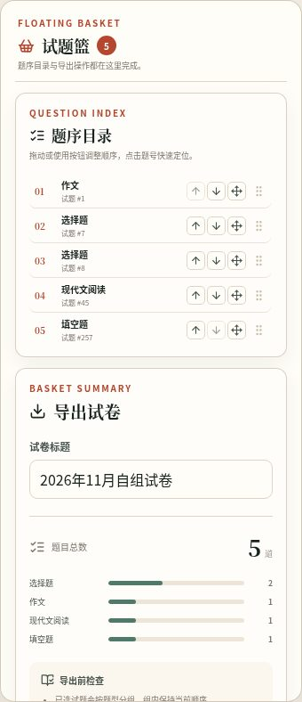
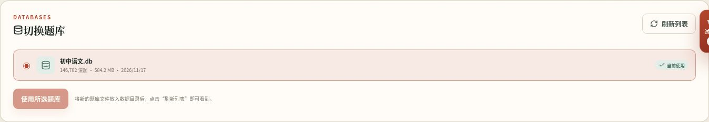

# 智能题库系统（React + FastAPI）

通用的本地题库工作台。系统主题、题库名称和学科内容由当前 SQLite 数据库决定，不局限于语文；切换数据库后，页面标题、统计和筛选项都会随新题库变化。

- 前端：React 19 + TypeScript + Vite，运行时使用已编译产物
- 后端：FastAPI + 原生 `sqlite3`
- 数据库：兼容原题库表结构的 SQLite 文件；仓库和离线包均不包含数据库
- DOCX：内置 HTML2DOCX 转换，与题库共用同一端口，**不使用 pandoc**
- 认证：无登录、无账号体系
- 试题篮：保存在浏览器 `localStorage`
- 当前示例题库：`初中语文.db`，146,782 道题、8,077 套试卷（需自行提供数据库文件）

GitHub：<https://github.com/ojijing/chinese-question-bank>

## 目录结构

```text
.
├── main.py                  # 项目总入口（FastAPI + 静态前端）
├── start.sh                 # 使用系统 Python 安装依赖并启动
├── requirements.txt
├── backend/                 # 后端功能模块
│   └── app/
│       ├── main.py          # FastAPI 应用
│       ├── routers/         # 题库、试卷、导出、参数、数据库接口
│       ├── services/        # SQLite 查询、HTML 组装、内置 DOCX 转换
│       ├── database.py
│       └── config.py
├── frontend/                # React 源码与构建配置
│   └── src/
│       ├── pages/           # 功能页面
│       ├── components/      # 复用组件
│       ├── context/         # 试题篮与提示消息状态
│       └── api/             # 后端接口封装
├── static/                  # 静态文件与前端构建产物
│   ├── app/                 # Vite 构建结果，运行时使用
│   ├── help.png
│   └── favicon.svg
├── data/
│   ├── data.db              # 本地数据库，需自行放置，已忽略提交
│   └── config.xlsx          # 难度、题型、知识点分类
├── docs/screenshots/        # 本 README 使用的界面截图
└── windows-package/
    └── 语文题库-Windows.zip # Windows 离线包，不含数据库和前端源码
```

功能模块、前端源码、静态文件、截图与数据文件分别存放，根目录 `main.py` 是统一入口。

## 页面预览

### 数据总览

展示当前题库的题量、试卷数、知识点数、题型分布、难度构成、重点知识板块和最近试卷。页面顶部的学科名称来自数据库 `db_info.file_name`。


### 题库检索

题干关键词、题型、难度和排序放在搜索结果上方；左侧为知识点树。切换知识点后，列表与统计会同步变化。



知识点树最多支持三级结构，点击一级、二级或三级节点都可以按该分类下的全部知识点筛选。



### 智能组卷

支持按数量、题型、难度、知识点和关键词随机抽题，并可以排除试题篮中已有的题目。



### 试卷浏览

按试卷名称搜索，查看原卷题目和题号索引，支持整卷加入试题篮或整卷导出。



### 试题篮与右侧悬浮区

试题篮页的题序目录和导出操作集中在右侧悬浮面板中。可拖拽题目或使用上移、下移、移动到按钮调整顺序。



右侧悬浮面板包含试卷标题、题目统计、导出前检查和导出按钮；导出成功后会自动清空试题篮。



### 题库切换

“使用说明”页会列出数据目录中的兼容数据库，可直接切换当前题库。切换后页面会重新加载，主题名称随数据库变化。



## 启动

### 1. 准备数据库

将 SQLite 数据库放到：

```text
data/data.db
```

数据库不随仓库或离线包分发。其他题库可放在 `data/` 目录中，然后在“使用说明”页切换。

数据库需要包含以下表及字段：

| 表 | 主要字段 |
|---|---|
| `Questions` | `ID`、`题干`、`解析`、`难度`、`知识点`、`来源`、`题型` |
| `Papers` | `ID`、`试卷` |
| `Knowledge` | `ID`、`知识点` |
| `Qtypes` | `ID`、`题型` |
| `Difficulties` | `ID`、`难度` |
| `db_info` | `file_name`、`question_count`、`max_id`、`encrypted` |

页面标题和主题名称读取 `db_info.file_name`。例如文件名是 `初中语文.db`，页面显示“初中语文 · 智能题库系统”。

### 2. 安装后端依赖

```bash
python3 -m pip install --break-system-packages -r requirements.txt
```

### 3. 启动题库

```bash
python3 main.py
```

或使用：

```bash
./start.sh
```

默认访问：

- 题库页面：<http://127.0.0.1:8000>
- 指定端口：`PORT=8001 python3 main.py`

`static/app` 已包含构建后的前端，普通运行不需要 Node，也不需要重新构建。

## 前端开发模式

仅在修改前端源码时需要：

```bash
cd frontend
npm install
npm run dev
```

开发页面地址为 <http://127.0.0.1:5173>，Vite 会把 `/api` 与 `/static` 代理到后端 `8000` 端口。修改完成后：

```bash
npm run build
```

构建结果写入 `static/app`。

## 主要功能

### 数据总览

- 题库总量、试卷数、知识点数、题型数
- 题型分布、难度构成、重点知识板块
- 最近试卷与导出使用提示
- 主题名称随当前数据库变化

### 题库检索

- 题干关键词、题型、难度和排序放在搜索结果上方
- 左侧知识点树最多支持三级结构
- 点击任意分类节点即可按该分类下全部知识点筛选
- 最新/最早排序与分页
- 查看解析、单题导出、在线编辑、加入试题篮
- 当前页批量加入试题篮

### 智能组卷

- 设置抽题数量
- 多选题型、多选难度
- 限定知识点或题干关键词
- 可排除试题篮中已有题目
- 随机结果整体或逐题加入试题篮

### 试卷浏览

- 按试卷名搜索
- 浏览原卷题目与快速题号索引
- 整卷加入试题篮
- 整卷导出 DOCX

### 试题篮

- 浏览器本地持久化
- 右侧悬浮面板集中管理题序目录与导出操作
- 支持拖动题目卡片或题序目录调整顺序
- 支持上移、下移和“移动到指定位置”
- 题序目录点击可快速定位题目，重排时带平滑动画
- 按题型统计
- 清空试题篮
- 导出成功后自动清空试题篮
- 三种导出格式：
  - 仅试题
  - 题目后跟解析
  - 答案放在卷末

### 题目编辑

- 修改题型、难度、知识点
- 富文本编辑题干与解析
- 实时试卷样式预览
- 保存后直接更新 SQLite `Questions` 表

### 题库参数

- 下载 `题库参数表.xlsx`
- 知识点参数表支持最多三级结构：

| 一级分类 | 二级分类 | 知识点 | ID |
|---|---|---|---|
| 基础知识及语言表达 |  |  |  |
|  | 字音字形 |  |  |
|  |  | 字音 | 5 |
|  |  | 字形 | 15 |

兼容原有“分类 / 知识点 / ID”三列写法。修改分类名称或层级时可保留 ID 不变。

### 切换题库

- 在“使用说明”页面列出数据目录中的题库文件
- 可选择并切换到另一套兼容题库
- 切换结果记录到 `data/current-db.txt`
- 切换前建议先导出或清空试题篮，避免题号含义变化

当前数据目录：`data/`

## 主要 API

| 方法 | 路径 | 说明 |
|---|---|---|
| `GET` | `/api/meta` | 题库元数据与统计 |
| `GET` | `/api/questions` | 搜索、筛选与分页 |
| `GET` | `/api/questions/{id}` | 获取单题 |
| `PUT` | `/api/questions/{id}` | 更新单题 |
| `POST` | `/api/questions/bulk` | 按 ID 批量获取 |
| `POST` | `/api/questions/random` | 随机抽题 |
| `GET` | `/api/papers` | 搜索与分页试卷 |
| `GET` | `/api/papers/{id}` | 获取整卷题目 |
| `POST` | `/api/exports/docx` | 生成并下载 DOCX |
| `GET` | `/api/config/export` | 下载题库参数表 |
| `GET` | `/api/databases` | 获取可切换题库列表 |
| `POST` | `/api/databases/switch` | 切换当前题库 |

状态检查、Swagger、ReDoc 和独立 HTML2DOCX HTTP 接口均已关闭。

## 环境变量

| 变量 | 默认值 | 说明 |
|---|---|---|
| `HOST` | `0.0.0.0` | 后端监听地址 |
| `PORT` | `8000` | 后端监听端口 |
| `RELOAD` | 空 | 设为 `1` 开启 uvicorn 热重载 |
| `TIKU_DB_PATH` | `data/data.db` | SQLite 路径 |
| `TIKU_CONFIG_XLSX` | `data/config.xlsx` | 参数表路径 |
| `TIKU_STATIC_DIR` | `static` | 静态文件目录 |

## DOCX 导出说明

HTML2DOCX 已内置在题库后端，与题库共用同一个端口，不依赖独立转换服务。

- 题库导出接口：`POST /api/exports/docx`
- HTML2DOCX 独立 HTTP 接口已关闭，转换逻辑只由题库导出接口内部调用

后端在内存中把题目 HTML 组装为完整试卷，调用内置转换器生成 DOCX，并直接返回浏览器。支持题干中的表格与图片（data URI、本地路径、网络地址）。不使用 pandoc。

## Windows 离线包

离线包位置：

```text
windows-package/智能题库-Windows.zip
```

特点：

- 内置 Python 3.12 运行时和全部依赖
- 前端已编译到 `static/app`，不包含 TSX 源码或 `node_modules`
- 不包含数据库文件
- 内置 HTML2DOCX 转换，不需要外部 8010 服务
- 解压后把数据库放到 `data/data.db`，双击 `启动题库.bat` 即可使用
